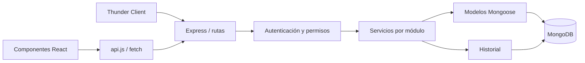

# Organización del proyecto y comparación con las fotografías

Actualización: 5 de noviembre de 2026.

## Primera fotografía: recorrido full stack

La fotografía ilustra una arquitectura con microfrontends, gateway, NATS, NestJS y Prisma. Campus conserva las tecnologías acordadas: React/Vite, Node.js, Express, Mongoose y MongoDB. La división en componentes no significa desplegar microfrontends o microservicios independientes.

| Capa de la fotografía | Implementación de Campus |
| --- | --- |
| UX/UI | Formularios etiquetados, diálogos con foco y Escape, estados de carga/error/vacío, filtros y navegación por rol. |
| Frontend React | Componentes reutilizables en `frontend/src/components/ui` y funcionalidades en `frontend/src/features`. |
| Petición HTTP | `frontend/src/api.js` centraliza `fetch`, JSON, Bearer y CSRF. Thunder Client también puede llamar directamente a la API. |
| Middleware | Express valida origen, JWT/sesión, permisos y datos; registra historial y normaliza errores. |
| Lógica de negocio | Servicios separados de acceso, instituciones, eventos, escenarios, inscripciones, deportes y hackatones. |
| Persistencia | Esquemas, referencias, índices y agregaciones de Mongoose/MongoDB. |
| Comunicación NATS | No se utiliza: los módulos se comunican dentro de la misma API. |
| NestJS / Prisma | No se utilizan: corresponden a un stack diferente del acordado para la materia. |

## Segunda fotografía: JWT y rotación de refresh tokens

Este flujo se incorporó a la aplicación. Se conservó también el acceso por Cookie de sesión para las peticiones existentes de la API.

1. `POST /api/auth/login` entrega un access token JWT de 15 minutos, el usuario y el token CSRF. El refresh token se envía como Cookie HttpOnly con vigencia máxima de 7 días.
2. El cliente conserva el access token únicamente en memoria y lo envía en `Authorization: Bearer ...`. No almacena tokens en localStorage.
3. Al recibir 401 en una petición protegida, el cliente llama a `POST /api/auth/refresh` con JSON. Las peticiones simultáneas comparten una sola renovación.
4. El servidor consume el refresh token de forma atómica, invalida la sesión anterior y emite nuevos tokens. MongoDB guarda solamente el hash del refresh token.
5. Si alguien reutiliza un refresh token consumido, se revoca su familia de sesiones. El cierre de sesión también invalida el refresh correspondiente.
6. El cliente reintenta una sola vez la petición original. Si la renovación falla, vuelve a solicitar acceso.

El refresh usa Cookie `HttpOnly`, `SameSite=Lax`, origen validado y cuerpo JSON; en producción utiliza `Secure`. Las escrituras de los recursos siguen requiriendo CSRF. La verificación JWT fija HS256, emisor y audiencia, y comprueba la sesión y la cuenta actuales. La política de rotación y detección de reutilización sigue el [RFC 9700, sección 4.14](https://www.rfc-editor.org/rfc/rfc9700.html#section-4.14); la firma y verificación utilizan [node-jsonwebtoken](https://github.com/auth0/node-jsonwebtoken).

## Dónde está cada responsabilidad

| Ubicación | Responsabilidad |
| --- | --- |
| `backend/src/server.js` | Conectar MongoDB y abrir/cerrar el servidor. |
| `backend/src/app.js` | Componer middleware y rutas de los módulos. |
| `backend/src/modules/auth` y `backend/src/security.js` | Acceso, JWT, refresh, hash y sesiones. |
| `backend/src/modules/shared/access.js` | Validaciones comunes, roles, elegibilidad y cola de escrituras. |
| `backend/src/modules/institutions` | CRUD y conservación de relaciones. |
| `backend/src/modules/catalogs`, `events`, `participants`, `teams` | Validación de configuración y referencias. |
| `backend/src/modules/venues` | Instalaciones, recursos y disponibilidad. |
| `backend/src/modules/registrations` | Inscripciones deportivas y tecnológicas, cupos, aprobación y retiros. |
| `backend/src/modules/sports` | Agenda, cruces, resultados, corrección y clasificación. |
| `backend/src/modules/hackathons` | Proyectos, presentación, rúbrica, asignación, evaluación y reporte. |
| `backend/src/modules/audit` | Registro del historial y su alcance por responsable. |
| `backend/src/modules/workflow` | Modelos y controladores HTTP de los flujos nuevos. |
| `backend/src/middleware/errors.js` | Contrato uniforme de errores JSON. |
| `frontend/src/App.jsx` | Restaurar sesión y elegir acceso o área de trabajo. |
| `frontend/src/features/layout` | Menú y composición de pantallas según rol. |
| `frontend/src/features` | Pantallas, formularios y detalles por funcionalidad. |
| `frontend/src/features/competitions/fields` | Componentes específicos de disciplinas, eventos, reglas, participantes, equipos e inscripción. |
| `frontend/src/components/ui` | Marca, campos, diálogos, tablas y avisos reutilizables. |
| `frontend/src/hooks/useResource.js` | Consulta de datos, cancelación de consultas previas y recarga. |

`competition-service.js`, `Accounts.jsx` y `Competitions.jsx` mantienen exportaciones de compatibilidad; la implementación está distribuida en sus módulos. Los comentarios explican validaciones, decisiones y conservación de datos, sin repetir cada instrucción del lenguaje.

## Permisos

| Rol | Alcance |
| --- | --- |
| Administrador | Cuentas, catálogos y gestión de todos los eventos. |
| Organizador | Eventos asignados, escenarios propios, programación, resultados, proyectos, jurados e historial de sus eventos. |
| Participante | Cuenta propia, participantes autorizados, equipos representados, inscripciones, proyectos autorizados y consultas de eventos publicados. |
| Jurado | Proyectos entregados que tenga asignados y sus propias evaluaciones, dentro de la ventana habilitada. |

Los permisos se verifican en el servidor aunque la interfaz o una petición manual envíe otro identificador. Los cambios de rol se consultan en las operaciones; desactivar o cambiar credenciales invalida el acceso anterior.

## Ejecución y alcance

Se mantienen `npm run dev`, los puertos 5173/3001 y MongoDB local. En producción configura `JWT_SECRET` con un secreto aleatorio de al menos 32 caracteres y HTTPS. En desarrollo, si falta esa variable, se genera una clave de firma por proceso.

Las pruebas usan bases temporales con nombres delimitados y datos ficticios. No reinician ni borran `torneos_universidad`. Los comentarios y las validaciones están pensados para explicar el recorrido HTTP → servicio → Mongoose → MongoDB durante la sustentación.

La coordinación de escrituras cubre una sola instancia de API. Para varias instancias se deben incorporar transacciones o coordinación distribuida y volver a comprobar cupos, agenda y cierre. No se ha introducido NATS ni una segunda aplicación para satisfacer las historias.
